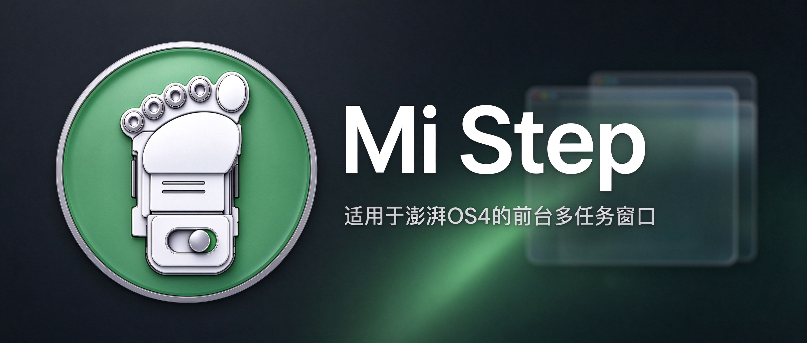
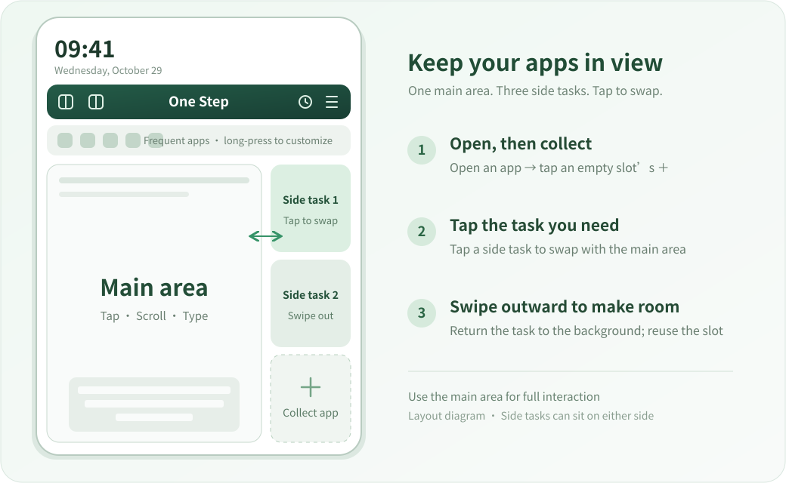
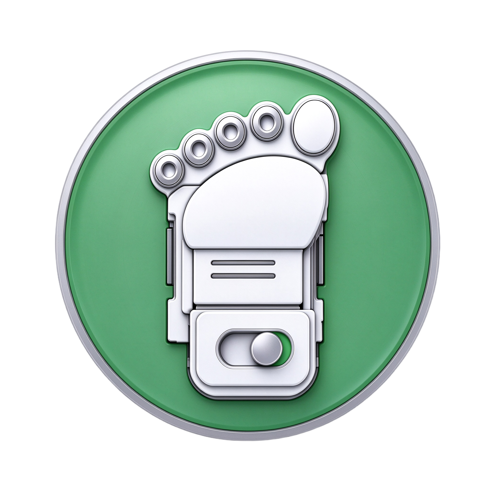

<a href="README.md">简体中文</a> · <strong>English</strong>

  

<h1 align="center">OneStepLite · A step forward for Xiaomi</h1>

  <strong>Built for HyperOS 4</strong> 
  One main window and multiple live tasks. Keep what you are doing in view.

  <kbd>1.0.4</kbd> &nbsp; <kbd>HyperOS 2 / 3 / 4</kbd> &nbsp; <kbd>Android 14+</kbd> &nbsp; <kbd>ARM64</kbd> &nbsp; <kbd>Root + LSPosed</kbd> &nbsp; <kbd>Source available · Noncommercial</kbd>

  <a href="https://github.com/JIUSIS/OneStepLite/releases/tag/v1.0.4"><strong>Download 1.0.4</strong></a> ·
  <a href="#features">Features</a> ·
  <a href="#installation-and-first-steps">Installation</a> ·
  <a href="#a-note-from-a-wish-making-engineer">Why I made it</a>

---

**Version 1.0.4 is now available.** It adds scrollable side windows and task retention across ordinary workspace exits, and improves rail scrolling and task switching. See the [changelog](docs/更新日志.md) for the full list and the validation scope of each version.

Most hands-on testing for 1.0.4 used a HyperOS 2 / Android 15 phone; that detail is recorded in the same [changelog](docs/更新日志.md).

## Multitasking that feels natural again

Keep notes beside your research. Reply to a message while watching a video. Move between several apps while working on the same thing. I wanted a workspace where I could see these tasks and switch between them easily.

**OneStepLite takes inspiration from Smartisan's One Step and brings that approach to foreground multitasking on Xiaomi HyperOS 4.** Your current desktop or app stays in the main window, with three side window slots alongside it. The clock, the title bar and the frequent app rail sit above. Tap the task you want to use to bring it into the main window.

  
   This is a layout and gesture diagram, not a screenshot. The side windows can also sit on the left.

## Features

### 01 · One main window, three real side windows

The main window keeps your current desktop or app usable. Three side windows sit beside it, so you can keep several apps in view. In tablet landscape the side area can grow to four slots.

**The ＋ in an empty slot collects the current main app.** Open the app in the main window, then tap an empty slot to place it there. Open another app and repeat to build your workspace. If the main window shows the desktop, you will be prompted to open an app first.

Side windows hold real system app tasks. Swapping uses the existing tasks and preserves their current pages. Refreshing, process reclamation and playback still depend on the app and Android.

### 02 · Tap to swap; interact in the main window

Tap a side window to bring it into the main window. The previous main app moves into the side area. Tap another task whenever you want to continue there.

- **Use the main window for full interaction:** tapping, scrolling, typing and the keyboard.
- **Use the side windows to choose and manage tasks:** tap to swap or swipe outward.
- Tapping a frequent app that is already a side window also brings that existing task into the main window.

The main window keeps input focus. Input is briefly protected during a handoff and restored after the final frame, helping prevent accidental touches or the keyboard following a side window.

Swapping has two modes, chosen under **Main and side swap behaviour** in the settings page:

| Mode | Behaviour |
| --- | --- |
| Follow the app (default) | The side app grows on its own side and the main window moves to the other side |
| Keep the main window in place | The main window stays where it is and only the apps swap |

A change applies from the next swap and does not move the current tasks immediately.

### 03 · Swipe outward to make room

Swipe a side window toward its nearest screen edge: left for windows on the left, right for windows on the right.

The slot becomes empty, and **the task returns to the system background without being deliberately closed**. You can reopen it through the desktop, recent apps or the frequent app rail.

### 04 · Frequent apps, within reach

The rail below the title bar shows your pinned apps first, followed by apps ordered by foreground usage over the last seven days. If usage statistics are unavailable, app names and other metadata provide a stable fallback order.

| Gesture | Action |
| --- | --- |
| Tap an app icon | Open it in the main window, or swap its existing side window into the main window |
| Swipe the rail horizontally | Browse icons outside the visible portion; the rail keeps scrolling after release |
| Long press an app icon | Choose custom apps with search and multi-select; tap Done to pin them in the chosen order |
| Long press again and clear a selection | Remove a pinned app; the rest keep the usage order |

Pins are stored per system user and survive leaving the workspace or a normal reboot.

### 05 · The one-step title bar: clock, title and four buttons

The top of the workspace is, from top to bottom, the clock, the title bar and the frequent app rail. All three derive from one fit factor, so they shrink together on small screens.

| Position | Content |
| --- | --- |
| Clock | Time and date, with an optional lunar date from the settings page |
| Title bar | The `One Step` title plus four fixed buttons |
| Frequent app rail | Pinned apps first, then the usage order |

The four buttons, left to right:

| Button | Action |
| --- | --- |
| Side windows on the left | Move the side area to the left; the main window moves to the right |
| Side windows on the right | Move the side area to the right; the main window moves to the left |
| System settings | Open system settings in the main window |
| Expand to fullscreen and leave the workspace | Close the workspace and restore the normal system interface |

The current side is shown as selected. **Long press the title text** to open the top landscape task face.

### 06 · The top landscape task face

The top area can hold one more directly usable app alongside the main window and the three side windows.

- Tap ＋ in the empty top slot to collect the current main app; the window supports single-finger interaction, paging and back.
- **Drag two fingers vertically in the top area** to switch between the title-bar face and the landscape task face, animated with the real app surface.
- **Swipe two fingers horizontally** to leave the top app in the background.
- An app changing orientation does not take over the top area automatically.
- Tablet landscape has a separate portrait task area; drag two fingers toward the main window to return the original task, and collecting again restores the main task it covered.

### 07 · Video docking and three fullscreen landscape modes

When a landscape fullscreen video starts, you can choose how the workspace makes room. The **Landscape video position** setting offers three modes, each with a diagram:

| Option | Behaviour |
| --- | --- |
| Play on top | Supported players can show the video at the top while the main and side windows keep working; unsupported players stay in the main window |
| Play inside the main window (default) | The video plays landscape inside the main window while the side windows keep working |
| Leave OneStepLite and play fullscreen | Leave OneStepLite and use the app's own fullscreen video interface |

Video docking **only takes over a floating video window the player already provides; it never resizes or moves the app task itself**. A change applies from the next landscape fullscreen video.

### 08 · The settings page: appearance, windows and actions, video, lock screen

Open it from **System settings → OneStepLite**, listed under "My device". There is no launcher icon. The page uses a consistent HyperOS 4 style and follows the system light or dark theme.

| Group | Settings |
| --- | --- |
| Appearance | Show lunar date |
| Windows and actions | Entry gesture, main and side swap behaviour, scroll side windows, hide side windows from recent apps |
| Video | Landscape video position |
| Lock screen | Restore OneStepLite after unlocking |

- **Scroll side windows**: drag the side column vertically to reach more side windows.
- **Hide side windows from recent apps**: applies only while OneStepLite is open and never closes the app.
- **Restore OneStepLite after unlocking**: when on, unlocking restores the previous window layout; when off, unlocking returns to the normal fullscreen interface.

Choices are stored on the device and survive leaving the workspace or a reboot.

### 09 · Left or right layouts and landscape inside OneStepLite

Swipe **right from the upper left corner** for side windows on the left, or **left from the upper right corner** for side windows on the right. You can also switch sides from the title bar at any time.

There are two entry gestures, chosen under **Entry gesture** in the settings page:

| Mode | Behaviour |
| --- | --- |
| Inward from the status bar (default) | Swipe inward from the left or right end of the status bar |
| Outward from the bottom | Swipe left or right from anywhere along the bottom edge; requires the system gesture hint line to be hidden first |

In immersive fullscreen, first reveal the native status bar without expanding notifications or quick settings, then start a new corner gesture. Entry remains blocked while the status bar is hidden. This rule also applies in landscape.

When an app enters landscape inside the main window, OneStepLite coordinates its orientation, touch mapping, task swaps and floating keyboard position. This means **an app in landscape inside the OneStepLite workspace**; app policies, keyboards and ROM versions can still differ.

## Installation and first steps

### Requirements

| Item | Current requirement |
| --- | --- |
| System | Requires **Android 14 / API 34** or later and targets HyperOS 2 / 3 / 4. See the [changelog](docs/更新日志.md) for device coverage. |
| Architecture | **ARM64** |
| Framework | Working **Root + LSPosed** |
| Development and validation devices | Xiaomi 17 Pro Max, Redmi Note 11T Pro |

Different ROMs on the same model may expose different interfaces. These targets are not a guarantee of compatibility with every device.

### Enable the module

The permanent package name is **`io.github.zerohomers0.onesteplite`**. Future versions will keep it. If you installed an earlier package name, exit the workspace and disable the old module in LSPosed first. Install this package, enable the new module, select its scope again, then reboot normally. You can uninstall the old module after confirming the new one works. A changed package name cannot overwrite the old installation; do not enable both modules together.

1. Download `OneStepLite-1.0.4.apk` from the [1.0.4 release](https://github.com/JIUSIS/OneStepLite/releases/tag/v1.0.4). Check it against `SHA256SUMS.txt` on that page.
2. Install it, enable **OneStepLite** in LSPosed and select the recommended scope below.
3. **Reboot normally** so the system processes load the module.
4. With the phone in portrait, use the upper corner swipe gesture. Open an app in the main window, then tap an empty side slot's ＋ to collect it.

| Scope | Package | Purpose |
| --- | --- | --- |
| System framework | `android` | System tasks, main window scaling and input |
| System UI | `com.android.systemui` | Workspace, title bar and native controls |
| Settings | `com.android.settings` | Native homepage entry for OneStepLite settings only |

Optionally select `com.xiaomi.type` to prevent the Xiaomi keyboard from automatically switching to floating mode in landscape. This remaining keyboard policy is independent of ordinary app layout and input. Settings is used only for the module entry; media players need no app scope. Previously saved LSPosed selections are not automatically cleared. See the [scope and system adaptation notes](docs/作用域与系统适配.md) (Chinese).

See the [full usage guide](docs/使用说明.md) for upgrades, signing and recovery. The linked detailed guides are currently in Chinese.

### Try a small workspace

Open a browser in the main window and tap ＋ to collect it. Open your notes and collect them into a second slot, then return to your chat app. You can now keep your reference material visible while replying. Tap your notes to add a few lines, then tap the chat to return. Swipe a side window outward when you need the slot for something else.

## A note from a wish-making engineer

  

The reason I started OneStepLite is simple: Xiaomi's floating windows never felt quite right to me, and I kept thinking about Smartisan's original One Step 3.0.

My background is in arts, sports and humanities. Before AI, writing code felt far out of reach. When I tried DS and MiMo in May, I realized AI could give me abilities and a kind of efficiency I had never had before. Later, with GPT as my teacher, I learned faster. I kept talking with it, learning and gradually putting my ideas into clearer words.

I still cannot write code fluently. But I have been learning to work like a product assistant: describe what I need, arrange tasks, watch the results and explain what is wrong. Somewhere along the way, I ended up making three or four little “toys.”

I only really decided to make OneStepLite after trying the community projects **OneStep4** and **Van Step**. Thank you to their creators for sharing their work. Trying them also helped me understand what I wanted: the ease of using Smartisan's original One Step 3.0 as I remembered it.

So I tried programming through natural language to make a version closer to my own ideas. To my surprise, it worked, and the first version felt worth continuing. I named it **OneStepLite**. The name might sound like Xiaomi's step counter, but I meant it as “a step forward for Xiaomi,” following the idea behind One Step.

As this “wish-making engineer,” I believe sharing knowledge helps ideas meet. Sharing what we have made, the mistakes we have made and what we have learned seems better than everyone taking the same wrong turns alone.

I also hope we can bring back some of the straightforward, friendly exchange I remember from the old Cool Market and MIUI forums. A little less hostility, a little more help. We can discuss a project, point out its problems and help each other take another step forward.

## Inspiration and thanks

| Project | Connection to OneStepLite |
| --- | --- |
| [SmartisanTech / android](https://github.com/SmartisanTech/android) | Smartisan's official source entry; One Step's interaction model inspired this project |
| [SangLuoCN / OneStep4](https://github.com/SangLuoCN/OneStep4) | A community project I tried that encouraged me to make my own |
| [Van Step](https://github.com/Xposed-Modules-Repo/com.hyper.sidebar) | A community project I tried that encouraged me to make my own |

OneStepLite is a personal project, not an official Xiaomi, Smartisan or community project release. These acknowledgments recognize the experience and inspiration; they do not imply participation in development, endorsement or compatibility guarantees.

## Documentation, feedback and source

| Topic | Start here |
| --- | --- |
| Installation, gestures, upgrades and recovery | [Usage guide](docs/使用说明.md) |
| Changes and validation scope per version | [Changelog](docs/更新日志.md) |
| Building and running tests | [Build guide](docs/构建说明.md) |
| Data scope and security | [Data and security](docs/数据与安全说明.md) |
| Scope responsibilities and system adaptation | [Scope and system adaptation](docs/作用域与系统适配.md) |
| Third-party components and licenses | [Third-party notices](THIRD_PARTY_NOTICES.md) |
| Noncommercial use and modified releases | [License guide](docs/许可说明.md) · [Full license](LICENSE) |
| Reporting issues and contributing | [Contributing](CONTRIBUTING.md) |

When reporting an issue, include the device, ROM version, OneStepLite version, app or keyboard and exact steps. For landscape issues, distinguish landscape inside OneStepLite from rotating the whole phone. Screenshots or recordings help; hide chats, account details and other personal information before sharing them.

<strong>For anyone who wants to explore the source</strong>

Workspace and system adaptation code lives in `app/src/main/java/`, grouped by function into `top`, `swap`, `workspace`, `video`, `input`, `lock`, `platform` and other sub-directories; native input mapping lives in `app/src/main/cpp/`. `tests/` and `tools/` contain policy checks, production method replays and package checks. On Windows, `build.ps1` and `test.ps1` build and test the complete source. Tools and commands are listed in the build guide.

The release includes an APK, product source ZIP, build information and SHA-256 checksums. The repository excludes signing keys, account credentials, device logs, personal screenshots or recordings, and vendor ROMs. The brand images were provided specifically for the project introduction.

I want to keep sharing what I learn, and I do not want someone to put a new shell around everyone's work and sell it. OneStepLite's original content uses the [OneStepLite Noncommercial Share-Alike Source License 1.0](LICENSE): noncommercial use, study, modification and free sharing are allowed. Distributed derivatives must include the complete corresponding source, retain attribution and use the same license.

## License: help improve it; please do not repackage it for sale

**Noncommercial sharing is allowed. Commercialization is prohibited. Distributed derivatives must provide complete corresponding source under the same license.**

| What you want to do | Rule |
| --- | --- |
| Use, study or privately modify it | Allowed for noncommercial purposes; private modifications need not be published |
| Share the original or release a free modified version | Retain attribution and the license; provide the complete source for that version |
| Rename it or change its interface and sell it | Prohibited |
| Charge for downloads, paid features or subscriptions; monetize ads or paid bundles | Prohibited |
| Distribute a modified version without its source | Prohibited |

This is **source-available software** under a custom license, `LicenseRef-OneStepLite-NC-SA-1.0`. Because it restricts commercial use, it is **not an OSI-approved open source license** and is not GPL-3.0. GPL-3.0 permits commercial use and paid distribution. The full conditions are in [LICENSE](LICENSE); **the Chinese license text controls**, and this English README is a reading aid, not a separate license grant.

The license also covers the original portions of the official 1.0.0 artifacts. Third-party components retain their own licenses. Source disclosure does not include signing keys, credentials or personal device material.

---

<strong>OneStepLite · A step forward for Xiaomi</strong> Put an idea into words, make it something you can use, then take the next step together.

