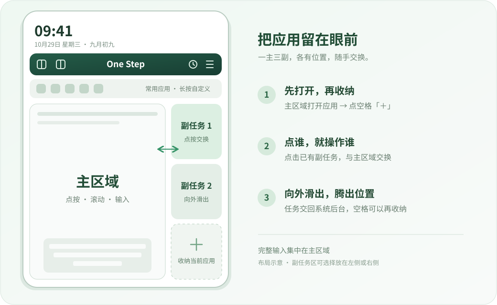

<strong>简体中文</strong> · <a href="README.en.md">English</a>

  

<h1 align="center">Mi Step · 小米的步伐</h1>

  <strong>真·适配 HyperOS 4</strong> 
  一个主窗，多个真实小窗，把正在做的事留在眼前。

  <kbd>1.0.4</kbd> &nbsp; <kbd>HyperOS 2 / 3 / 4</kbd> &nbsp; <kbd>Android 14+</kbd> &nbsp; <kbd>ARM64</kbd> &nbsp; <kbd>Root + LSPosed</kbd> &nbsp; <kbd>源码公开 · 非商用</kbd>

  <a href="https://github.com/JIUSIS/MiStep/releases/tag/v1.0.4"><strong>下载 1.0.4</strong></a> ·
  <a href="#功能详解">功能详解</a> ·
  <a href="#安装与上手">安装与上手</a> ·
  <a href="#一个许愿工程师的自述">项目缘起</a>

---

**1.0.4 正式版**新增无限小窗、普通退出后保留小窗任务，并优化了快捷栏滚动和任务切换。完整改动与各版本验证范围见[更新日志](docs/更新日志.md)。

1.0.4 的分项设备测试主要在澎湃 OS 2 / Android 15 手机上完成，详情同样记录在[更新日志](docs/更新日志.md)。

## 一步，回到顺手的多任务

查资料时留着笔记，看视频时顺手回消息，在几个应用之间来回处理同一件事——我想要的，是把这些事情放在一个看得见、切得动的工作区里。

**Mi Step 参考锤子科技 One Step「一步」的交互思路，为小米 HyperOS 4 适配前台多任务体验。** 当前桌面或应用显示在主窗，旁边留出三个小窗位置，顶部是时钟、标题栏和常用应用栏。需要操作哪个任务，就点它换到主窗。

  
   布局与操作示意，并非实际界面截图；小窗区也可以放在左侧。

## 功能详解

### 01 · 一个主窗，三个真实小窗

主窗保留当前桌面或应用的操作空间；三个小窗按格排列，与主窗并排显示，方便同时查看几个应用的内容。平板横屏时小窗区可扩展到四格。

**空格上的「＋」用来收纳当前主应用。** 先在主窗打开要留下的应用，再点一个空小窗格，它就会进入那个位置。继续打开其它应用、继续收纳，逐步搭好自己的工作区。主窗是桌面时，会提示先打开应用。

小窗承载的是系统中的真实应用任务。切换围绕已有任务进行，保留任务当前的页面；应用自身的刷新、后台回收和播放策略仍由应用及系统决定。

### 02 · 点一下交换，把输入留给主窗

点击已有小窗，它会进入主窗，原主应用则交给小窗区。用完再点另一个任务，就能继续接着做事。

- **主窗负责完整操作**：点击、滚动、输入文字和使用键盘。
- **小窗区负责选择与管理**：点按交换、向外滑出。
- 点击常用应用栏中已在小窗的应用，也会将已有任务换回主窗。

主窗保持输入焦点；任务交接时保留短暂的输入保护，完成后继续操作，减少误触或键盘跑到小窗上的情况。

交换有两种模式，在设置页的「主窗与小窗交换方式」中选择：

| 模式 | 行为 |
| --- | --- |
| 随应用切换位置（默认） | 小窗中的应用在原侧放大，主窗随之切换位置 |
| 保持主窗位置 | 主窗保持在当前一侧，只交换主窗与小窗中的应用 |

切换从下一次交换主窗与小窗开始生效，不会立即移动当前任务。

### 03 · 向外滑出，给下一个任务腾位置

暂时不用某个小窗时，向它所在的屏幕外侧滑出：小窗区在左边就向左，在右边就向右。

滑出完成后，该位置恢复为空格，**任务交回系统并留在后台，不主动结束应用**。之后可以从桌面、最近任务或常用应用入口继续打开它。

### 04 · 常用应用栏，少走几次桌面

标题栏下方是常用应用栏，优先显示自定义固定的应用，其余按最近七天的前台使用情况排列；无法读取使用统计时，使用应用名称等信息保持稳定排序。

| 操作 | 作用 |
| --- | --- |
| 点击应用图标 | 在主窗打开应用；已在小窗时交换已有任务 |
| 左右滑动应用栏 | 浏览当前没有露出的图标，松手后支持惯性滚动 |
| 长按应用图标 | 打开自定义应用选择框，支持搜索与多选；点完成按选择顺序固定在最前 |
| 再次长按并取消勾选 | 移除固定项，其余应用继续按常用顺序排列 |

配置按系统用户保存，退出工作区或正常重启后保留。

### 05 · 一步标题栏：时钟、标题与四个按钮

工作区顶部从上到下是时钟、标题栏和常用应用栏，三者由同一个缩放系数推导，小屏上会一起收窄。

| 位置 | 内容 |
| --- | --- |
| 时钟 | 时间、日期，可在设置页开启农历 |
| 标题栏 | `One Step` 标题 + 四个固定按钮 |
| 常用应用栏 | 固定应用在前，其余按最近使用排列 |

四个按钮从左到右分别是：

| 按钮 | 作用 |
| --- | --- |
| 小窗放在左侧 | 把小窗区移到左边，主窗随之换到右侧 |
| 小窗放在右侧 | 把小窗区移到右边，主窗随之换到左侧 |
| 系统设置 | 在主窗打开系统设置 |
| 放大为全屏并退出工作区 | 关闭工作区，恢复普通系统界面 |

当前所在的一侧会以选中状态标出。**长按标题文字**可打开顶部横屏任务面。

### 06 · 顶部横屏任务面

顶部区域可以再保留一个可直接操作的应用，与主窗和三个小窗并存。

- 在顶部空位点「＋」收纳当前主屏应用；窗口内可单指操作、换页和返回。
- **双指在顶部区域上下滑动**，可在标题栏面与横屏任务面之间切换，切换使用真实应用画面动画。
- **双指横向滑出**可将顶部应用留在后台。
- 应用方向变化不会自动占用顶部。
- 平板横屏有独立竖屏任务区，可双指向主窗滑回原任务，再次收纳时恢复被覆盖的主任务。

### 07 · 视频接入，三种横屏全屏处理

横屏全屏视频进入时，可以选择工作区如何让位。设置页的「横屏视频显示位置」提供三种方式，每种都配有示意图：

| 选项 | 行为 |
| --- | --- |
| 顶部播放 | 支持的播放器可在顶部显示视频，主窗和小窗仍可使用；不支持时保留在主窗播放 |
| 主窗内播放（默认） | 视频在主窗内横屏播放，小窗仍可使用 |
| 退出 MiStep，全屏播放 | 退出 MiStep，使用应用原有的全屏播放界面 |

视频接入**只接管播放器已经提供的悬浮视频窗口，不改变应用任务本身的大小和位置**。设置从下一次进入横屏全屏开始生效。

### 08 · 设置页：外观、窗口与操作、视频、锁屏

从 **系统设置 → Mi Step** 打开，入口位于「我的设备」下方，无独立桌面图标。界面采用统一的澎湃 OS 4 风格，跟随系统浅色/深色主题。

| 分组 | 设置项 |
| --- | --- |
| 外观 | 显示农历 |
| 窗口与操作 | 打开 MiStep 的手势、主窗与小窗交换方式、滚动切换小窗、在最近任务中隐藏小窗应用 |
| 视频 | 横屏视频显示位置 |
| 锁屏 | 解锁后恢复 MiStep |

- **滚动切换小窗**：上下滑动小窗区域，查看更多小窗。
- **在最近任务中隐藏小窗应用**：仅在 MiStep 打开时生效，不会关闭应用。
- **解锁后恢复 MiStep**：开启后解锁恢复原有窗口布局；关闭后解锁返回正常全屏界面。

选择保存在本机，退出或重启后保留。

### 09 · 左右布局，以及一步内部的横屏

从**左上角向右**滑动，小窗区在左；从**右上角向左**滑动，小窗区在右，可以按左右手习惯选择。也可以在标题栏里随时切换。

打开 MiStep 的手势有两种，在设置页的「打开 MiStep 的手势」中选择：

| 模式 | 行为 |
| --- | --- |
| 状态栏向内滑（默认） | 从状态栏左侧或右侧向屏幕中间滑动 |
| 底部向外滑 | 从屏幕底部任意位置向左或向右滑动；需先在系统设置中关闭手势提示线 |

沉浸全屏中需先拉出原生状态栏，保持通知与快捷面板未展开，再另起角部手势；未拉出时拒绝。此规则也适用于横屏。

应用在一步主窗内进入横屏时，工作区会协调页面方向、触摸映射、主窗与小窗交换和悬浮键盘位置。这里的横屏指**一步区域内的应用横屏**；不同应用的横屏策略、输入法和系统版本仍可能带来兼容差异。

## 安装与上手

### 运行环境

| 项目 | 当前要求 |
| --- | --- |
| 系统 | 最低安装版本 **Android 14 / API 34**；适配 HyperOS 2 / 3 / 4，实际验证范围见[更新日志](docs/更新日志.md) |
| 架构 | **ARM64** |
| 框架 | 已配置可用的 **Root + LSPosed** |
| 开发与验证设备 | Xiaomi 17 Pro Max、Redmi Note 11T Pro |

相同机型、不同 ROM 也可能有接口差异；当前适配范围不等于全机型兼容承诺。

### 启用模块

模块包名统一为 `com.jiusis.mistep`，后续版本继续使用这个包名。已安装旧包名版本时，先退出工作区并在 LSPosed 中停用旧模块，再安装此包、启用新模块并重新选择作用域，最后正常重启；确认正常后可卸载旧模块。旧包名版本无法直接覆盖升级，请避免同时启用两个模块。

1. 从 [1.0.4 发行页](https://github.com/JIUSIS/MiStep/releases/tag/v1.0.4) 下载 `MiStep-1.0.4.apk`，可用同页的 `SHA256SUMS.txt` 核对文件。
2. 安装后，在 LSPosed 中启用 **Mi Step**，选择模块推荐作用域。
3. **正常重启手机**，使系统进程加载模块。
4. 在竖屏界面用上角横滑手势打开工作区，先在主窗打开一个应用，再点空格「＋」收纳。

推荐作用域如下：

| 作用域 | 包名 | 说明 |
| --- | --- | --- |
| 系统框架 | `android` | 系统任务、主窗缩放与输入适配 |
| 系统界面 | `com.android.systemui` | 工作区、标题栏与原生控件 |
| 设置 | `com.android.settings` | 仅提供系统设置首页的 Mi Step 入口 |

使用小米输入法且需要阻止横屏时自动变成悬浮键盘，可另行选择 `com.xiaomi.type`。这是现有输入法内部策略的可选兼容项，普通应用显示和输入不依赖它。「设置」仅用于模块入口；播放器不需要加入作用域。升级不会代替用户清除 LSPosed 中保存的旧勾选，可自行取消多余项。职责与未迁移项见[作用域与系统适配](docs/作用域与系统适配.md)。

覆盖升级、签名与停用恢复步骤见[完整使用说明](docs/使用说明.md)。

### 第一次搭工作区，可以这样试

在主窗打开浏览器，点空格「＋」收纳；再打开笔记，收进第二格；然后回到聊天应用。现在可以看着资料回消息，点笔记换到主窗补几句，再点聊天换回来。需要腾位置时，把暂时不用的小窗向外滑出即可。

## 一个“许愿工程师”的自述

  

做 Mi Step 的起因其实很简单：我一直觉得小米的悬挂小窗不太顺手，也一直惦记着锤子原版的一步 3.0。

我是个“艺体文”，在 AI 出现之前，敲代码这件事对我来说实在太遥远。今年五月接触到 DS 和 MiMo 后，我才发现，AI 能让我获得一些以前很难拥有的能力和效率。后来有了 GPT 老师，学得更快了，我就不断地和它交流、学习，把自己的想法一点点讲清楚。

到现在，我还是不会熟练地敲代码。但我慢慢学着站在产品助理的位置上，描述需求、安排任务、观察效果、反馈问题。就这样，前前后后也做出了三四个小“玩具”。

Mi Step 则是在我体验了社区大佬的 **OneStep4** 和 **Van Step** 之后，才真正想动手做的。感谢他们把作品带到社区，也让我更确定了自己想要的体验：我想找回的，是自己记忆里锤子原版一步 3.0 的那种顺手。

于是，我试着用自然语言编程，做一个更贴近自己想法的一步。没想到，还真做出来了，初版效果也让我觉得值得继续。我给它取名 **Mi Step**。这名字可能会让人联想到“小米步数”，但我的意思是：既然脱胎于 One Step 的想法，那就叫它“小米的步伐”。

本“许愿工程师”相信，知识分享才会带来头脑风暴。把做过的东西、踩过的坑和摸索出来的经验拿出来交流，总比各自关起门来走弯路好。

我也希望，我们还能找回当年“酷市场”和“MIUI 论坛”里那种纯粹的交流氛围。社区少一点戾气，多一点互相帮助；作品可以讨论，问题可以指出，每个人也都可以在别人的帮助下往前走一步。

## 参考与致谢

| 项目 | 与 Mi Step 的关系 |
| --- | --- |
| [SmartisanTech / android](https://github.com/SmartisanTech/android) | 锤子科技官方开源入口；One Step 的交互思路是本项目的参考起点 |
| [SangLuoCN / OneStep4](https://github.com/SangLuoCN/OneStep4) | 我体验过、并促使我动手尝试的社区作品 |
| [Van Step](https://github.com/Xposed-Modules-Repo/com.hyper.sidebar) | 我体验过、并促使我动手尝试的社区作品 |

Mi Step 是个人项目，并非小米、锤子科技或上述社区项目的官方产品。对社区作品的致谢表示体验与创作启发，不代表它们参与开发、为本项目背书或提供兼容保证。

## 文档、反馈与源码

| 想了解什么 | 从这里开始 |
| --- | --- |
| 安装、手势、升级与恢复 | [使用说明](docs/使用说明.md) |
| 各版本改动与验证范围 | [更新日志](docs/更新日志.md) |
| 从源码构建和运行测试 | [构建说明](docs/构建说明.md) |
| 数据范围与安全说明 | [数据与安全说明](docs/数据与安全说明.md) |
| 作用域职责与系统适配 | [作用域与系统适配](docs/作用域与系统适配.md) |
| 第三方组件及许可 | [第三方说明](THIRD_PARTY_NOTICES.md) |
| 源码使用、改版发布与非商用要求 | [许可说明](docs/许可说明.md) · [许可全文](LICENSE) |
| 报告问题与提交改进 | [参与项目](CONTRIBUTING.md) |

反馈问题时，请说明手机型号、系统版本、Mi Step 版本、应用/输入法名称和具体操作顺序。涉及横屏时，也请说明是一步内部横屏还是整机横屏。截图或录像能帮助说明问题，发送前请遮住聊天、账号等个人信息。

<strong>给想看源码、一起折腾的朋友</strong>

工作区与系统适配代码位于 `module/src/main/java/`，按功能分为 `top`、`swap`、`workspace`、`video`、`input`、`lock`、`platform` 等子目录；原生输入映射位于 `module/src/main/cpp/`；`tests/`、`tools/` 提供策略测试、生产方法回放和包检查。Windows 下可通过 `build.ps1`、`test.ps1` 完整构建与测试，所需工具及命令见构建说明。

发行页提供 APK、产品源码 ZIP、构建信息及 SHA-256 清单。仓库不包含本机签名私钥、账号凭据、设备日志、个人截图录像或厂商 ROM；文档中的品牌图片是为项目介绍单独提供的素材。

我希望继续分享知识，也不希望有人把大家的成果套个壳就拿去卖。Mi Step 自有内容采用 [Mi Step 非商用共享源码许可 1.0](LICENSE)：允许非商用的使用、学习、修改与免费分享；分发改版必须公开完整对应源码、保留署名并沿用同一许可。

## 许可：欢迎一起改进，请勿套壳售卖

**允许非商用分享，禁止商业化，分发衍生版本必须公开完整对应源码并沿用同一许可。**

| 你想做的事 | 规则 |
| --- | --- |
| 自己使用、学习，或修改后自用 | 允许非商用使用；仅供自己使用的修改无须公开 |
| 免费转发原版或发布改进版 | 保留署名及许可，提供该版本完整对应源码 |
| 换名字、换界面后卖钱 | 禁止 |
| 付费下载、会员解锁、广告变现、收费捆绑 | 禁止 |
| 拿源码修改后闭源分发 | 禁止 |

本项目采用自定义的 **Mi Step 非商用共享源码许可 1.0**，准确归类为
**源码公开（Source Available）**。由于限制商业化，它不属于 OSI 定义
下的开源许可，也不是 GPL-3.0；GPL-3.0 本身允许商用和收费分发。
完整条件见 [LICENSE](LICENSE) 和 [许可说明](docs/许可说明.md)。

本次许可同时适用于官方 1.0.0 发行物中的原创部分。第三方组件保留
各自许可；公开源码不包括签名私钥、账号凭据或设备个人材料。

---

<strong>Mi Step · 小米的步伐</strong> 把想法讲出来，把体验做出来，再一起往前走一步。

